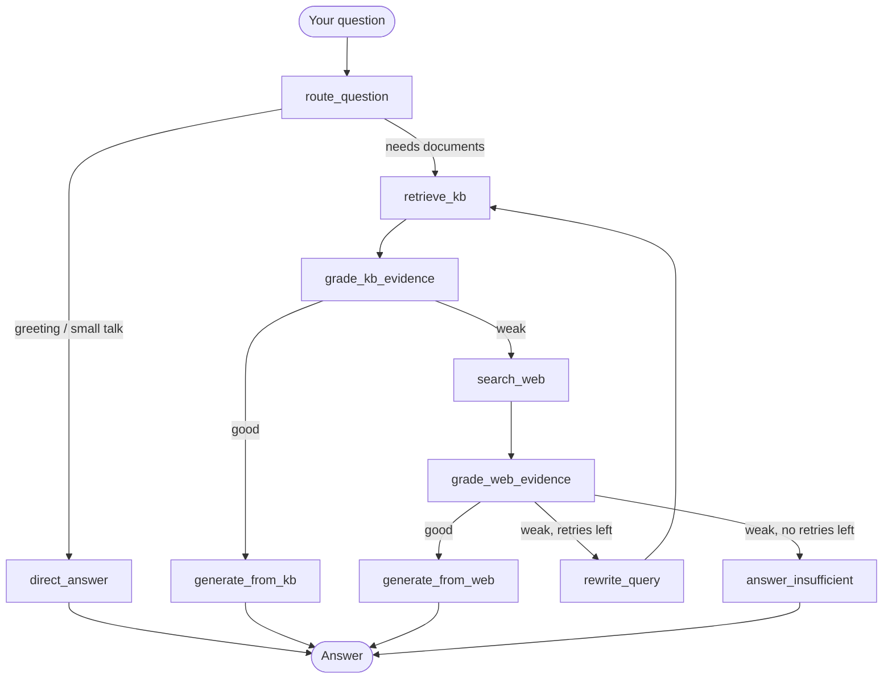

#  Agentic RAG Document Assistant

Upload your PDF, TXT or Markdown files and chat with them. The assistant answers from **your documents**, shows **citations with page numbers**, and automatically **falls back to web search** when your documents don't contain the answer.


<!-- Add a screenshot at docs/screenshot.png -->

##  Features

- 📄 Upload and chat with PDF, TXT and MD files
- 📌 Citations: see which file and page each answer came from, with snippets
- 🧠 Agentic workflow: grades its own evidence, rewrites queries and retries
- 🌐 Web search fallback (Tavily) when documents aren't enough
- 💬 Conversation memory: follow-ups like "explain that more simply" work
- 🔒 Private by design: uploads live in memory per session and vanish on refresh
- 🔑 Bring your own API keys: nothing is billed to the host
- 👀 Live progress steps so you can see what the agent is doing

##  Tech stack

| Part | Tool |
|---|---|
| UI | Streamlit |
| Agent workflow | LangGraph |
| LLM | Groq |
| Embeddings | HuggingFace (`all-MiniLM-L6-v2`) |
| Vector store | ChromaDB (in memory, per session) |
| Web search | Tavily |

## How the workflow works

Every question travels through a LangGraph state machine. Each box below is a node; the agent decides which way to go based on what it finds.



### Step by step

1. **Route:** The router decides whether the message is a greeting or a real question. If it's a real question and there is chat history, the question is rewritten into a standalone one (so "what about the second one?" becomes a full question).
2. **Retrieve:** The question is turned into an embedding and the 3 most similar chunks are pulled from your uploaded documents.
3. **Grade documents:** An LLM grader checks whether those chunks can actually answer the question → `good` or `weak`.
4. **Answer from documents:** If `good`, the model answers using **only** those chunks and cites them as `[1]`, `[2]`. The UI shows the file name, page and a snippet for each source.
5. **Web fallback:** If `weak`, the agent searches the web with Tavily (if a Tavily key was provided).
6. **Grade web results:** The web evidence is graded the same way. If `good`, the answer is written from it, with URLs.
7. **Rewrite and retry:** If the web evidence is also weak, the query is rewritten to be more search-friendly and the loop starts again from retrieval (up to `MAX_RETRIES` times).
8. **Give up honestly:** If nothing works, the assistant says it couldn't find enough evidence instead of guessing.

### Shared state

All nodes read and write a single shared state (`state.py`): the question, retrieved chunks, grades, the answer, citations and recent chat history.

## 📁 Project structure

```
.
├── app.py                  # Streamlit UI
├── agentic_rag/
│   ├── __init__.py
│   ├── config.py           # settings + model/search factories
│   ├── state.py            # shared agent state + structured outputs
│   ├── ingestion.py        # file parsing, chunking, per-session vector store
│   ├── nodes.py            # the agent's steps (route, retrieve, grade, answer...)
│   ├── graph.py            # wires the nodes into the workflow
│   └── main.py             # builds the agent; also a terminal chat mode
├── .streamlit/config.toml  # upload size limit
├── requirements.txt
├── .env.example
└── LICENSE
```

##  Run locally

Requires **Python 3.10+**.

```bash
git clone https://github.com/YOUR_USERNAME/YOUR_REPO.git
cd YOUR_REPO

python -m venv .venv
# Windows:  .venv\Scripts\activate
# macOS/Linux:  source .venv/bin/activate

pip install -r requirements.txt

cp .env.example .env      # Windows: copy .env.example .env
# edit .env and add your keys (optional, you can also paste them in the app)

streamlit run app.py
```

Then:
1. Enter your **Groq API key** in the sidebar ([get one free](https://console.groq.com/keys)).
2. *(Optional)* Enter a **Tavily key** to enable web search ([get one free](https://app.tavily.com)).
3. Upload documents and click **Process Documents**.
4. Ask questions!

You can also chat in the terminal: `python -m agentic_rag.main`

## ⚙️ Configuration

| Variable | Default | Purpose |
|---|---|---|
| `GROQ_API_KEY` | none | Groq key (used only if `ALLOW_SERVER_KEYS=true`) |
| `TAVILY_API_KEY` | none | Tavily key (same rule) |
| `ALLOW_SERVER_KEYS` | `true` | Set `false` on public deployments so users must bring their own keys |
| `GROQ_MODEL` | `openai/gpt-oss-20b` | Groq model name |
| `EMBEDDING_MODEL` | `sentence-transformers/all-MiniLM-L6-v2` | Embedding model |
| `MAX_RETRIES` | `1` | Rewrite-and-retry attempts |

Upload size per file is set in `.streamlit/config.toml` (`maxUploadSize`, in MB).

## ☁️ Deploy

**Streamlit Community Cloud / Hugging Face Spaces**
1. Push the repo to GitHub.
2. Create a new app pointing at `app.py`.
3. In the platform's *secrets / environment variables*, set `ALLOW_SERVER_KEYS=false`.
4. Don't add your own API keys to a public app. Users enter their own.

The first load is slow because the embedding model is downloaded.

## ⚠️ Known limitations

- Scanned PDFs (images without text) aren't supported yet. OCR is on the roadmap.
- Uploads are per session and are deleted when the page is refreshed (by design).
- Answers appear all at once rather than streaming token by token.
- Quality depends on the LLM and on how well the PDF text extracts.

## 🗺️ Roadmap

- [ ] OCR for scanned PDFs
- [ ] DOCX support
- [ ] Streaming answers
- [ ] Hybrid search and reranking
- [ ] Unit tests and an evaluation set

## 🤝 Contributing

Issues and pull requests are welcome.

## 📄 License

MIT. See [LICENSE](LICENSE).